  

  
  
  
  

  Business Innovation student who <b>builds the things he proposes</b>. Most of what I ship starts as a process problem 
  someone described to me in a meeting: AI agents, automation and the architecture around them.

### About

- **Now** · Working Student, Business Engineering, at **Zurich Insurance**: building an AI agent for open-source software risk assessment and mapping enterprise architecture to find bottlenecks in end-to-end process automation.
- **Studying** · M.A. Business Innovation at the **University of St. Gallen (HSG)**, concentration in Transforming and Managing Digital Business.
- **Thesis** · Scaling AI solutions in DACH automotive companies through enterprise architecture.
- **Hackathons** · 🏛️ **Zentral Hack 2026** (Agentic AI, Staatsarchiv Schwyz) · 💳 **Start Hack 2026** (Viseca challenge) · 🏅 Zurich Insurance internal hackathon.
- **Before** · Data Analytics at **Astara** · Internship at **Mercedes-Benz Switzerland**.

### Featured work

  <a href="https://github.com/REPO_LINK"><b>Code</b></a> ·
  <a href="DEMO_LINK">Demo</a> ·
  Built with <a href="https://github.com/rogerjeasy">@rogerjeasy</a>

  
  

<b>How the Quellen-Finder works</b>

 
PDFs are chunked into ~800-character passages with LangChain, each embedded into a 768-dimension vector using a multilingual HuggingFace model, and indexed in Pinecone with filename and page metadata. A textual-overlap check runs next to the semantic match, so you can see whether a direct quote or a paraphrase is the honest choice.

### Tech stack

  

  
  
  
  
  
  
  
  
  
  

### Focus areas

  Enterprise architecture · AI adoption at scale · Process automation · Business intelligence · FinOps

### Activity

  <picture>
    <source media="(prefers-color-scheme: dark)" srcset="https://streak-stats.demolab.com/?user=richardtnkl&hide_border=true&background=0B0F1A&stroke=253047&ring=8B5CF6&fire=22D3EE&currStreakNum=E6EDF3&sideNums=E6EDF3&currStreakLabel=22D3EE&sideLabels=8B98A9&dates=8B98A9">
    
  </picture>

📍 Near Zurich, Switzerland · 🗣️ German · English · Malayalam · Thanks for stopping by, <a href="https://www.linkedin.com/in/richard-thanikkal">say hello</a>.

